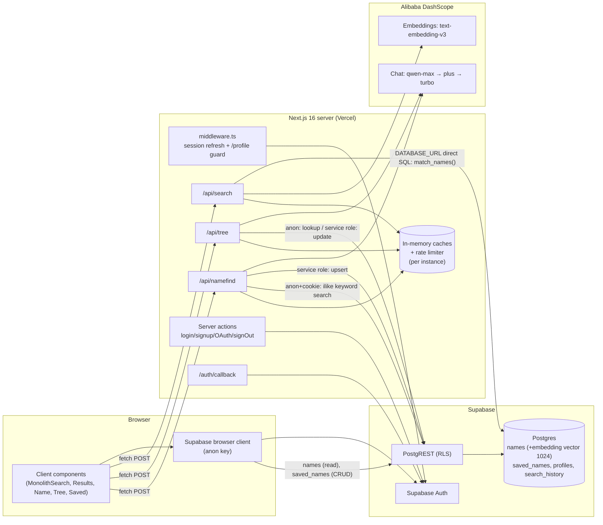
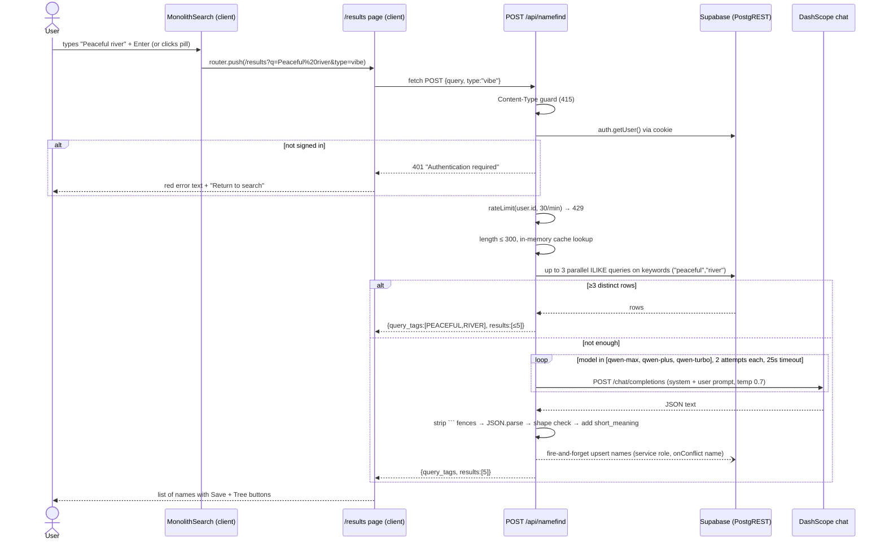
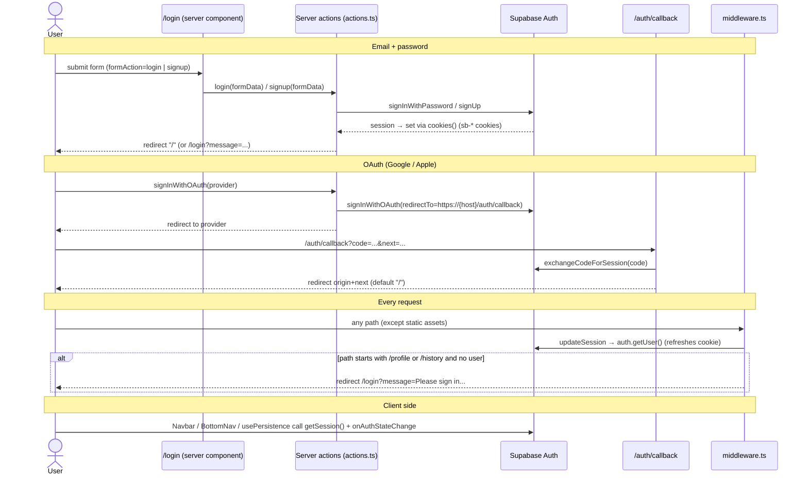
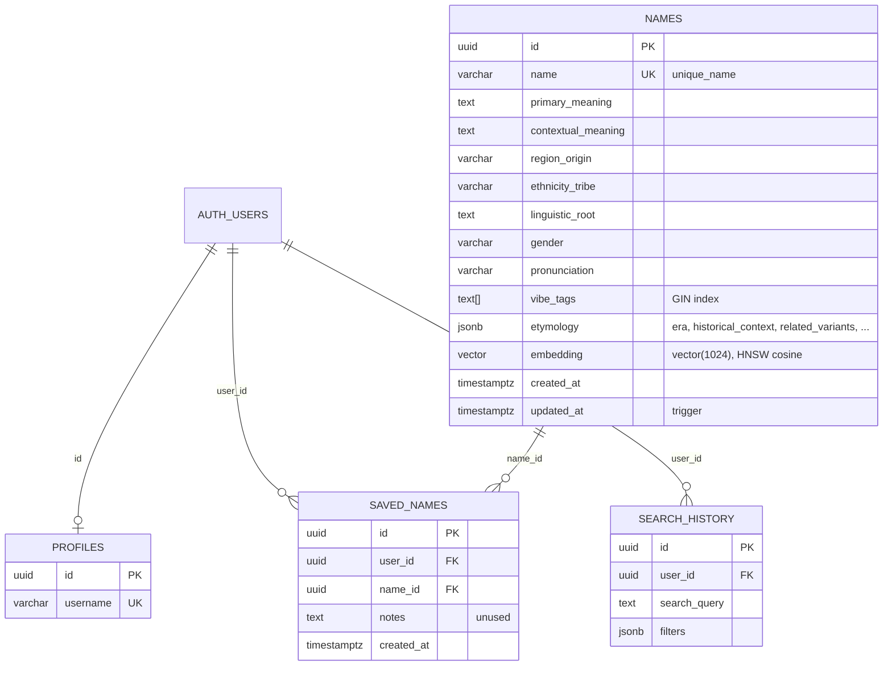

# Namefinder — Architecture

> Phase 1 output of the codebase review. Read-only mapping as of commit `0bb751f` (2026-11-14).
> Package name: `namefind-tmp`. UI brand: "Namefinder" / "Namefind | Monolith". Repo/README name: "NameFindQ".

---

## 1. Plain-English overview

Namefinder is a single Next.js app that does three jobs:

1. **Serves the UI.** Almost every page is a client component (`"use client"`) built with Tailwind v4 and Framer Motion in a black/white "Monolith" style with terracotta (`#C1694F`) and cyan (`#38BDF8`) accents.
2. **Proxies AI calls.** Three API route handlers under `app/api/*` talk to **Alibaba Cloud DashScope (Qwen)**:
   - `/api/namefind` asks a Qwen chat model (`qwen-max` → `qwen-plus` → `qwen-turbo` fallback chain) for JSON name lists. It powers **Vibe** and **Blend**.
   - `/api/tree` asks Qwen for an etymology "lineage tree" for one name. It powers **Tree** and the tree on the name detail page.
   - `/api/search` asks Qwen for a **text embedding** (`text-embedding-v3`, 1024 dimensions), then runs a pgvector similarity query. It powers **Semantic** search.
3. **Stores data in Supabase.** Supabase Postgres holds a `names` dictionary (seeded from `data/*.json`, then grown by AI results) with a `vector(1024)` embedding column, plus a per-user `saved_names` table. Supabase Auth handles email/password and Google/Apple OAuth through `@supabase/ssr` cookie sessions.

Every AI-backed request checks first in this order: an in-memory cache, then the Supabase `names` table ("DB-first"), and only then Qwen. AI results are written back to `names` with the service-role key, so the dictionary grows over time. The old `walkthrough.md` calls this the "caching logic".

**Deployment.** The live site is on Vercel (`namefinder-tan.vercel.app`), but the repo also has a full Docker pipeline (`Dockerfile`, `scripts/build-push.*`, `output: 'standalone'`) aimed at **Alibaba Cloud Function Compute 3.0**. The repo has no `vercel.json`.

---

## 2. Tech stack

| Concern | Choice | Where |
|---|---|---|
| Framework | **Next.js 16.2.4, App Router** (no `pages/`) | `package.json`, `app/` |
| React | 19.2.4 | `package.json` |
| Language | TypeScript 5.9, `strict: true`, `allowJs` | `tsconfig.json` |
| Styling | Tailwind CSS v4 (`@tailwindcss/postcss`), custom CSS utilities | `app/globals.css`, `postcss.config.mjs` |
| Animation | framer-motion 12 | most components |
| Fonts | `next/font/google`: Playfair Display + Geist Mono | `app/layout.tsx` |
| State | Local `useState` only; one custom hook `usePersistence`. No global store | `app/hooks/usePersistence.ts` |
| Database | Supabase Postgres + **pgvector** (HNSW cosine index) + `pg_trgm` | `supabase/schema.sql`, `scripts/*.sql` |
| DB access | Two paths: `@supabase/supabase-js` (PostgREST, RLS-aware) **and** raw `postgres` (porsager) with `DATABASE_URL` for vector search | `utils/supabase/*`, `app/api/search/route.ts` |
| ORM | None | — |
| Auth | Supabase Auth via `@supabase/ssr` (cookie sessions); email+password, Google, Apple OAuth | `app/login/actions.ts`, `middleware.ts`, `app/auth/callback/route.ts` |
| AI / LLM | Alibaba DashScope Qwen (OpenAI-compatible endpoint). Chat: raw `fetch`. Embeddings: `openai` SDK v6 pointed at DashScope | `app/api/*/route.ts`, `lib/qwenClient.ts` |
| Vector store | pgvector inside Supabase (`names.embedding vector(1024)`, `match_names()` SQL function) | `scripts/create-match-function.sql` |
| Validation | `zod` 4 is installed; a schema is defined but **not actually used** to parse AI output | `app/api/namefind/route.ts:9` |
| Testing | Vitest 4 (node env), 2 files | `tests/`, `vitest.config.ts` |
| Lint | ESLint 9 flat config, `eslint-config-next` core-web-vitals + typescript | `eslint.config.mjs` |
| Hosting | Vercel (live); Docker → Alibaba FC 3.0 (scripted) | `Dockerfile`, `scripts/build-push.*` |

---

## 3. Folder / file map

```
app/
  layout.tsx                 Root layout: fonts, metadata, Navbar + BottomNav, light-leak backdrop
  page.tsx                   Home ("Discovery"); client component wrapping <MonolithSearch/>
  globals.css                Tailwind import, theme tokens, dot-grid bg, .glass-card / light-leak utilities
  results/page.tsx           Vibe/Blend results; POSTs /api/namefind; save + "view tree" buttons
  name/[id]/page.tsx         Name detail; reads `names` directly from Supabase in the browser; embeds <EtymologyTree/>
  tree/page.tsx              Lineage page; ?name=X → live tree, no param → hard-coded "Lucius" demo
  saved/page.tsx             Saved collection list (via usePersistence)
  login/page.tsx             Server component: sign-in/up form + Google/Apple buttons, or "signed in" card
  login/actions.ts           Server actions: login, signup, signOut, signInWithOAuth
  profile/page.tsx           Server component: account details; redirects if not signed in
  auth/callback/route.ts     OAuth / email-confirm code → session exchange
  api/namefind/route.ts      POST: Vibe & Blend name generation (cache → DB keyword match → Qwen chat → upsert)
  api/tree/route.ts          POST: etymology tree (cache → DB row → Qwen chat → enrich DB row → fallback)
  api/search/route.ts        POST: semantic search (Qwen embedding → pgvector match_names)
  hooks/usePersistence.ts    Client hook: auth state + saved names (Supabase) + toggleSave
  components/
    MonolithSearch.tsx       Home search: vibe/blend/semantic tabs, suggestion pills, routes to /results
    SearchBar.tsx            Semantic input; POSTs /api/search
    SearchResults.tsx        Semantic results list, skeleton + empty state
    VibeScanner.tsx          5-bar "typing" animation (also used as a loading spinner)
    EtymologyTree.tsx        Tree renderer; POSTs /api/tree; ships a static DEMO tree
    Navbar.tsx               Top bar: hamburger drawer, logo, avatar dropdown / Login
    BottomNav.tsx            Fixed bottom tab bar (Discovery, Tree, Saved, Login/Account)
    NameBlender.tsx          ⚠ UNUSED: standalone two-input blender, expects an outdated API shape
    NameDiscoveryCard.tsx    ⚠ UNUSED: large card with fake "MAPBOX_VIS_ACTIVE" art
    DataCard.tsx             ⚠ UNUSED: glass card with migration-path SVG
lib/
  qwenClient.ts              Singleton OpenAI-SDK client pointed at DashScope (used only for embeddings now)
  rateLimiter.ts             In-memory fixed-window rate limiter (Map + setInterval)
  supabase.ts                ⚠ EMPTY FILE
utils/supabase/
  client.ts                  createBrowserClient (anon key)
  server.ts                  createServerClient bound to next/headers cookies
  middleware.ts              updateSession(): refreshes Supabase auth cookie on every request
middleware.ts                Runs updateSession; guards /profile and /history (⚠ Next 16 renamed this to proxy.ts)
next.config.ts               output: 'standalone'; security headers (CSP, HSTS, XFO, etc.)
supabase/schema.sql          Tables names, profiles, saved_names, search_history + RLS + trigram/GIN indexes
scripts/
  seed.ts                    Bulk-insert data/{Igbo,Edo,yoruba}.json into names (⚠ "Igbo.json" vs file "igbo.json")
  create-match-function.sql  Adds embedding vector(1024), HNSW index, match_names()
  run-match-function.ts      Executes the SQL above (npm run db:deploy-fn)
  generate-embeddings.ts     Embeds every names row WHERE embedding IS NULL (npm run db:embed)
  migrate-vector-dimension.* One-off 1536→1024 migration (old Gemini → Qwen)
  check-embeddings.ts        Counts rows with/without embeddings
  test-rag.ts                Manual end-to-end embedding + match_names check
  build-push.{sh,ps1}        Docker build & push to Alibaba Container Registry
data/
  igbo.json, Edo.json, yoruba.json   Seed dictionaries (~200 names each, same shape as `names` columns)
  african_names.json                 Small sample; not referenced by seed.ts
tests/
  unit.test.ts, logic.test.ts        Vitest: they RE-IMPLEMENT the logic under test instead of importing it
test-api.mjs                 Manual HTTP smoke test against localhost:3000
test-api.js, test_inspect.js ⚠ Leftovers (test_inspect.js requires @google/genai, which is not installed)
walkthrough.md               Points at a local PNG on the author's machine; dead link in the repo
Dockerfile, .dockerignore    3-stage build to standalone server (node:18-alpine)
```

---

## 4. Diagrams

### (a) System architecture



### (b) Request flow: one Vibe search ("Peaceful river")



### (c) Auth flow



---

## 5. Data model

From `supabase/schema.sql` plus `scripts/create-match-function.sql`:



**RLS:** `names` can be read by everyone and written only by the service role. `saved_names` and `search_history` allow select/insert/delete where `auth.uid() = user_id`. `profiles` allows select/update on your own row.

**Unused tables:** `profiles` and `search_history` are never read or written by app code.

**`match_names(query_embedding, match_threshold, match_count)`** returns `id, name, primary_meaning, contextual_meaning, vibe_tags, ethnicity_tribe` for rows with cosine similarity ≥ threshold, ordered by distance. The app calls it with threshold `0.4` and count `8`.

**Embeddings** are precomputed offline by `npm run db:embed` from `"Name: … Tribe: … Meaning: … Context: … Vibes: …"`. ⚠ Names that the AI adds at runtime via upsert get **no embedding**, so they stay invisible to Semantic search until someone re-runs the script.

---

## 6. API routes & server actions

| Endpoint | Method | Input | Output | Auth | Rate limit | External calls |
|---|---|---|---|---|---|---|
| `/api/namefind` | POST, JSON | `{query: string ≤300, type?: 'vibe'\|'blend'\|any}` | `{query_tags: string[], results: NameResult[]}`; on Qwen 429 a fake "RATE_LIMITED" placeholder payload with status 200; errors `{error}` 400/401/415/429/500 | **Required** (Supabase user) | 30/min per user id (in-memory) | Supabase select (anon+cookie), DashScope chat ×≤6, Supabase upsert (service role) |
| `/api/tree` | POST, JSON | `{name: string ≤100}` | `TreeData` (`source: db\|ai\|fallback`). Always 200 except validation/500 | **None (public)** | 10/min per IP from `x-forwarded-for` | Supabase select, DashScope chat ×≤6, Supabase update by id (service role) |
| `/api/search` | POST, JSON | `{query: string ≤200}` | `{query, results: NameSearchResult[≤8]}` | **Required** | 60/min per user id | DashScope embeddings (12s timeout), direct Postgres `match_names()` |
| `/auth/callback` | GET | `?code&next` | 302 to `origin+next` or `/login?message=Auth error` | — | — | Supabase `exchangeCodeForSession` |
| `login` | server action | FormData `email`, `password` | redirect `/` or `/login?message=<supabase error>` | — | none | `signInWithPassword` |
| `signup` | server action | FormData `email`, `password` | redirect `/login?message=Check email…` | — | none | `signUp` |
| `signOut` | server action | — | redirect `/` | — | — | `signOut` |
| `signInWithOAuth` | server action | `'google'\|'apple'` (bound inline in login page) | redirect to provider URL | — | — | `signInWithOAuth`, redirectTo built from the `Host` header |

**Browser → Supabase directly (no API route):**
- `name/[id]/page.tsx` reads `select('*').from('names').ilike('name', id)`.
- `usePersistence` reads `saved_names` joined with `names(name, primary_meaning)` for the current user, looks up `names.id` by `ilike(name)`, and inserts or deletes `saved_names`.

---

## 7. Environment variables

Values intentionally not shown.

| Variable | Exposed to client? | Used in |
|---|---|---|
| `NEXT_PUBLIC_SUPABASE_URL` | Yes (by design) | `utils/supabase/{client,server,middleware}.ts`, `middleware.ts`, `app/api/namefind/route.ts:147`, `app/api/tree/route.ts:144`, `Dockerfile` build arg |
| `NEXT_PUBLIC_SUPABASE_ANON_KEY` | Yes (by design, RLS-protected) | same Supabase util files, `middleware.ts`, `Dockerfile` |
| `SUPABASE_SERVICE_ROLE_KEY` | No (server only) | `app/api/namefind/route.ts:144`, `app/api/tree/route.ts:142` (DB writes) |
| `DATABASE_URL` | No | `app/api/search/route.ts:24`, all `scripts/*.ts` |
| `QWEN_API_KEY` | No | `lib/qwenClient.ts`, all three API routes, `scripts/generate-embeddings.ts`, `scripts/test-rag.ts` |
| `QWEN_BASE_URL` | No (optional, defaults to `dashscope-intl…/compatible-mode/v1`) | same as above |
| `NODE_ENV` | — | `app/login/actions.ts:55` (http vs https for OAuth redirect) |

The local `.env.local` also has commented-out leftovers for OpenAI/Anthropic/Gemini/Pinecone keys and an old DB password. The repo has **no `.env.example`**; the README documents the variables instead. `.env*` is gitignored. Git history will be checked in Phase 3.

---

## 8. AI prompts & output handling

### `/api/namefind`: Vibe & Blend
- **System prompt** (`app/api/namefind/route.ts:29-54`): "expert onomastic historian". Output must be one JSON object with `query_tags` (UPPERCASE) and `results[]`, each with `name, primary_meaning, contextual_meaning, region_origin, ethnicity_tribe, linguistic_root, gender, pronunciation, etymology_node{era, historical_context}`. Returns 5 results for vibe/semantic and 3 for blend.
- **User prompt** (`:133-138`):
  - blend → `Blend query: "<query>". Merge phonetic and semantic qualities of both roots into 3 synthesized name variations with full etymologies.`
  - else → `Vibe query: "<query>". Return the 5 best matching names (real or synthesized) with etymologies and migration data.`
  - User text is interpolated directly inside quotes, with no delimiting or escaping.
- **Model call:** raw `fetch` to `{base}/chat/completions`, `temperature 0.7`, **no** `response_format: json_object`, no `max_tokens`, no streaming.
- **Parsing** (`:256-268`): strip ```` ```json ```` fences → `JSON.parse` → check that `query_tags` exists and `results` is an array → add `short_meaning`. **`NameResultSchema` (zod) is declared but never called**, so per-item fields are never validated. A parse failure lands in the outer catch and returns 500 with the raw error message.

### `/api/tree`: Lineage
- **System prompt** (`app/api/tree/route.ts:31-59`): "onomastic historian and etymologist". JSON with `root_label, root_meaning, primary_epoch, primary_context, region, tribe, branches[3]{name, meaning, variant_type∈{Direct, Extended, Feminine, Short Form, Modern}, sub_variant, sub_variant_region}, narrative`.
- **User prompt** (`:230`): `Generate etymology tree JSON for "<name>". <seedContext>`. The seed context pulls the existing DB row's fields into the prompt as "Known data: …".
- **Parsing** (`:266-274`): strip fences → `JSON.parse`. On failure it serves `buildFallbackTree`. **There is no shape check at all**: a valid-JSON but wrong-shaped answer goes straight to the client (and `EtymologyTree` destructures `branches[0..2]`) and gets written into the DB.
- **Fallback trees** (`buildFallbackTree`, `mapDbToTree`) **invent variants** by appending letters (`Name+a`, `Name+i`, `Name+io`, …) and label them "Feminine variant", "Extended form", etc. The UI shows these as if they were real etymology.

### `/api/search`: Semantic
- No prompt. Embedding only: `text-embedding-v3`, `dimensions: 1024`, with a length check (must be 1024).

---

## 9. Feature walkthrough

### Vibe
`MonolithSearch` (vibe tab) → Enter or pill → `/results?q=…&type=vibe` → `ResultsContent` POSTs `/api/namefind` → (cache | DB keyword ILIKE | Qwen) → list rendered with name, `short_meaning`, a **Save** button (`usePersistence.toggleSave`) and a **Tree** button (`/tree?name=`). Clicking a name goes to `/name/[name]`. The "Load More" button does nothing.

**Signed-out users** get a 401 and see "AUTHENTICATION REQUIRED. PLEASE SIGN IN." in red. The home page doesn't tell them that login is needed.

### Blend
The same path as Vibe, with `type=blend`, from the "blend" tab of `MonolithSearch` (placeholder `Root + Root...`, pills like "Yoruba + Celtic"). The route skips the DB-first lookup and asks Qwen for 3 synthesized names. The richer two-input `NameBlender.tsx` UI exists but is **not mounted anywhere**. It also reads `data.name` / `data.etymology`, which this API no longer returns, and shows a random "Match Resonance %" and random ID.

### Semantic Search
`MonolithSearch` (semantic tab) → `SearchBar` POSTs `/api/search` → Qwen embedding (cached 1h in memory) → `match_names(vec, 0.4, 8)` over direct Postgres → `SearchResults` shows tribe, name, meaning, context and coloured vibe tags, each linking to `/name/[name]`. Results stay on the home page (no URL state). **This tab has no suggestion pills**, even though the home page hint text advertises "Igbo names meaning wealth", and that example sits under the Vibe tab.

### Tree
- `/tree` with no param shows a **hard-coded "Lucius" demo** and a static "Structural Analysis" paragraph about Indo-European roots. Nothing on the page lets you enter a name.
- `/tree?name=X` (from the Results "Tree" button or the name page's "View Full Lineage") → `EtymologyTree` POSTs `/api/tree` → (cache | sufficient DB row → `mapDbToTree` | Qwen | fallback) → renders root → primary name → 3 branches → sub-variants → narrative.
- `name/[id]` embeds the same tree.
- "Save to Tree" and "Compare Names" buttons do nothing.
- `/api/tree` is **public** (no auth), unlike the other two AI routes.

### Saved
- `usePersistence` is instantiated separately in each page (Results, Name, Saved). Each call creates its own auth subscription and fetches.
- **Signed in:** loads `saved_names` joined with `names` for `user.id`. `toggleSave` updates the UI optimistically, looks up `names.id` by case-insensitive `ilike(name)`, then inserts or deletes the `saved_names` row. If the name isn't in `names` yet (e.g. the fire-and-forget upsert hasn't finished, or failed), it **silently returns** and the UI keeps showing "saved" until the next reload.
- **Signed out:** `toggleSave` redirects to `/login`. It *reads* `localStorage['namefind_saved']` but nothing ever *writes* it, so that branch is dead.
- `/saved` is not protected server-side. When signed out it shows the empty state.
- The name detail page checks `isSaved(displayTitle)` using the **capitalized** name. Seed data is lowercase (`"chidiebere"`), so the saved indicator can be wrong there, and saving from that page stores a lowercase/capitalized mismatch.

### Login / auth
Described in diagram (c). The session lives in Supabase `sb-*` cookies managed by `@supabase/ssr`. The server side uses `getUser()` (validated); the client side uses `getSession()` (unvalidated, fine for UI only). `/profile` is guarded twice (middleware + page redirect). `/history` is guarded but **no such page exists**. Navbar and BottomNav each create their own auth listener.

---

## 10. Open questions, unfinished, dead or confusing

**Unfinished / stub UI**
1. "Load More" (`results/page.tsx:264`), "Save to Tree" and "Compare Names" (`EtymologyTree.tsx:225-230`) have no handlers.
2. `/tree` without a name is a static demo with no input. What is the Tree page supposed to be?
3. `/history` is guarded in the middleware and the `search_history` table exists, but there's no page and nothing writes to it.
4. `profiles` table and `saved_names.notes` column are unused.

**Dead code / leftovers**
5. `NameBlender.tsx`, `NameDiscoveryCard.tsx`, `DataCard.tsx` are never imported.
6. `lib/supabase.ts` is empty.
7. `getQwenClient` is imported but unused in `namefind` and `tree`. Those routes now use raw `fetch` (commit `65502c4`), so there are two different ways of calling the same provider.
8. `NameResultSchema` is defined but never used.
9. `test-api.js`, `test_inspect.js` (references the uninstalled `@google/genai`), `walkthrough.md` (links to a file on a local machine).
10. `data/african_names.json` is not seeded. `seed.ts` asks for `Igbo.json` but the file is `igbo.json`, which only works on case-insensitive filesystems (Windows/macOS), not on Linux CI.
11. `run-match-function.ts:35` prints an example using a 1536-dim vector (stale after the 1024 migration).
12. The vitest suites copy the production logic instead of importing it, so they can pass while the real code drifts.

**Confusing / inconsistent**
13. **Deployment target.** Vercel is live, but the Dockerfile, README and scripts target Alibaba FC. Which one is canonical? (The in-memory cache and rate limiter behave differently on each.)
14. **Next 16 middleware → proxy rename.** The bundled docs (`node_modules/next/dist/docs/01-app/01-getting-started/16-proxy.md`) say Middleware is now called Proxy. `middleware.ts` still works but uses the deprecated name.
15. **Naming.** NameFindQ / Namefinder / Namefind | Monolith / `namefind-tmp`.
16. **Semantic is a third mode on the API side** (`type` accepts anything), but the UI's semantic tab goes to `/api/search` instead.
17. **Three ways to talk to Postgres:** supabase-js anon (RLS), supabase-js service role, and raw `postgres` with `DATABASE_URL` (bypasses RLS).
18. **Runtime-added names lack embeddings**, so the AI-grown dictionary never reaches Semantic search.
19. **Fallback "etymologies" are fabricated** by string concatenation and shown as data.
20. On a Qwen 429, `/api/namefind` returns **HTTP 200 with fake names** (`"<Query>"`, `"<Query>ian"`), which the UI shows as real results.
21. The README says Node 18+ and the Dockerfile uses `node:18-alpine`, but Next 16 requires Node ≥ 20.9. To verify in Phase 2.

**Decisions (Checkpoint 1)**
- **Deployment:** support both Vercel (live) and Docker → Alibaba FC. Audits and fixes cover both targets (e.g. the Docker base image must move off Node 18).
- **Auth gate:** move to a **limited free tier**. Signed-out users get a small number of searches per IP before being asked to sign in. Login stays required for Saved.
- **Tree page:** with no name, show a **name input** plus the existing demo as the starting state.
- **Supabase plan:** Free tier for now, with an upgrade only once the site earns revenue. Recommendations must fit Free-tier limits (500 MB database, limited direct connections, pausing after 7 days of inactivity) and avoid paid-only features.
